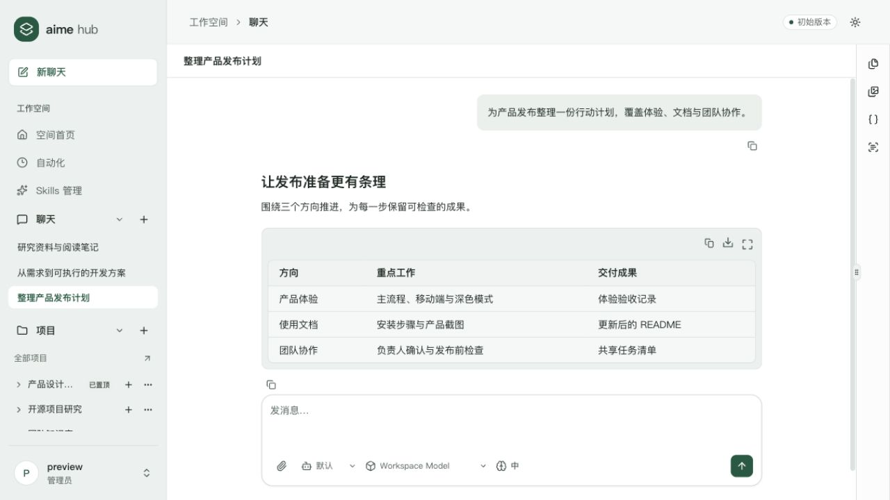

# Aime Hub

**简体中文** · [English](README.en.md)

Aime Hub 是一个可自行部署的 AI 工作空间。在个人聊天里，你可以让 Agent 分析文件、执行命令或操作浏览器；需要协作时，可以在项目中共享对话和工作目录，并把重复任务设为定时自动化。模型服务由管理员接入。



[本地快速开始](#本地快速开始) · [生产部署](#生产部署) · [参与开发](#参与开发) · [使用与管理手册](docs/usage.zh-CN.md)

## 工作空间能做什么

| 场景           | 使用方式                                                                                                                                   |
| -------------- | ------------------------------------------------------------------------------------------------------------------------------------------ |
| 处理个人任务   | 在[个人聊天](docs/personal-chat.md)中选择模型或 Agent，上传材料、查看工具结果。关闭标签页不会停止服务端正在执行的对话。                    |
| 团队协作       | 在[项目](docs/projects.md)中管理成员、共享聊天与文件，让团队围绕同一份材料工作。                                                           |
| 复用知识与工具 | 用知识库检索参考资料，用 Skill 保存可重复使用的任务说明，通过 MCP 连接外部工具。                                                           |
| 定时运行       | 为个人或项目配置自动化并查看运行结果。任务按服务端时区执行，服务器需要保持在线。                                                           |
| 扩展业务功能   | [全栈插件](plugins/README.md)可同时提供页面、API、Agent 和工具。例如 [Vibe Quant](plugins/vibe-quant/README.md) 提供行情、策略回测与回放。 |

## 本地快速开始

以下步骤在本机运行前端和 API，仅用 Docker 启动数据库。需要 Git、Node.js **≥ 22.13.0**、**pnpm 10.12.1** 和支持 `--wait` 的 Docker Compose。如果已有带 pgvector 的 PostgreSQL，可跳过启动容器的命令，将 `DATABASE_URL` 指向自己的数据库。

### 1. 安装依赖，设置认证密钥

```sh
git clone https://github.com/DarkNoah/aime-hub.git
cd aime-hub
pnpm install --frozen-lockfile
cp .env.example .env
openssl rand -base64 32
```

将最后一条命令的输出填入 `.env` 的 `BETTER_AUTH_SECRET`。示例配置中的数据库地址与本地 Compose 一致（`127.0.0.1:55432`）；如果修改数据库密码或端口，请同步修改 `DATABASE_URL`。完整配置见[环境变量示例](.env.example)。

### 2. 初始化数据库与管理员

```sh
docker compose -f compose.local.yaml up -d --wait
pnpm db:migrate
pnpm auth:create-admin
```

按提示输入用户名、邮箱和密码。管理员用户名需列在 `ADMINS` 中，示例值为 `admin`。**没有默认密码**，仅修改 `ADMINS` 也不会将已有用户提升为管理员。

### 3. 启动服务，发送第一条消息

```sh
pnpm dev
```

1. 打开[本地工作空间](http://127.0.0.1:5173)，用刚创建的管理员账号登录。想先浏览界面，可以打开[免登录产品预览](http://127.0.0.1:5173/home)。
2. 在 **管理后台 → 模型供应商**（`/admin/providers`）填写供应商 API 地址和凭据，同步或手动添加模型并启用。示例环境变量中的 `OPENAI_API_KEY` 和 `DEFAULT_MODEL` 不会自动配置聊天模型。
3. 打开 **个人聊天**（`/threads`），选择已启用的模型并发送消息。如果要让 Agent 使用工具，请选择支持工具调用的模型。

**遇到问题？** 先通过[健康检查](http://127.0.0.1:5173/api/health)确认前端能连通 API。如果局域网访问可以打开页面但无法登录，将浏览器的实际来源（协议、主机和端口）加入 `WEB_ORIGINS`，然后重启服务。只有使用浏览器工具时才需额外安装 Chromium：`pnpm --filter @aime/server exec playwright-core install chromium`；Linux 还需要对应的系统库。

## 生产部署

使用 [compose.yaml](compose.yaml) 启动 Web、API 和 PostgreSQL；[compose.local.yaml](compose.local.yaml) 只启动开发数据库。域名、反向代理、升级和可选 E2B 桌面的完整步骤见[部署指南](docs/deployment.md)。

- **访问入口：** 默认 Compose 不发布 Web 宿主端口。让反向代理指向 `web:80`，并将实际 HTTPS 来源填入 `WEB_ORIGINS`。
- **初始化：** 为生产环境单独生成数据库密码和认证密钥。容器启动时自动迁移数据库；首次部署后，在 `server` 容器执行 `pnpm auth:create-admin`。
- **持久化：** 同时备份 `postgres-data`（账号、配置、消息）和 `workspace-data`（工作文件）。限制数据库、模型请求日志及备份的访问权限，它们可能包含供应商凭据或完整对话。
- **宿主要求：** 默认配置挂载 `/dev/fuse` 以支持 AgentFS。普通部署不需要 E2B；需要独立桌面时再叠加 [compose.e2b.yaml](compose.e2b.yaml)。

## 参与开发

| 目录                         | 职责                                                              |
| ---------------------------- | ----------------------------------------------------------------- |
| [apps/web](apps/web/)        | React / Vite 前端，按聊天、项目、自动化和管理后台等业务模块组织。 |
| [apps/server](apps/server/)  | Hono / oRPC API、Mastra Agent 运行时、工具与业务服务。            |
| [packages](packages/)        | 认证、数据库、共享类型，以及插件 SDK 和 UI。                      |
| [plugins](plugins/README.md) | 随宿主构建的可信插件，以及基于 Notebook 示例的开发指南。          |

在仓库根目录运行 `pnpm test` 执行测试，`pnpm typecheck` 检查类型，`pnpm lint` 检查代码，`pnpm build` 构建前后端。全部命令见 [package.json](package.json)。

按主题阅读：[系统架构](docs/architecture.md) · [Agent 执行工具](docs/exec-tool.md) · [模型供应商](docs/模型供应商模块.md) · [开发环境 API 文档](http://127.0.0.1:5173/api/docs) · [贡献约定](AGENTS.md)。

## 许可证

仓库未提供 `LICENSE` 文件；使用、修改或分发前，请向维护者确认授权条款。
